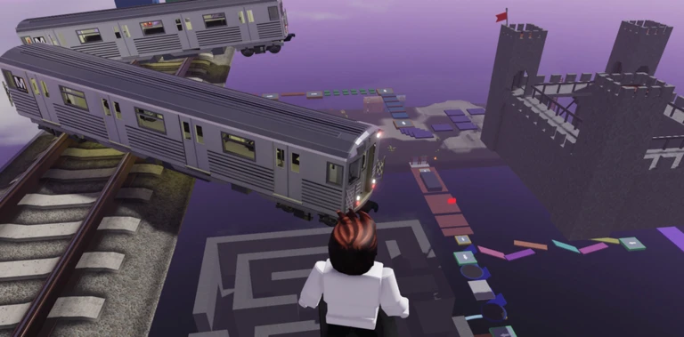
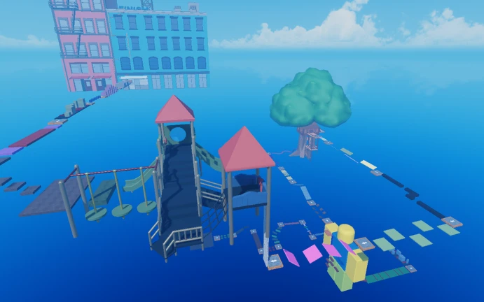
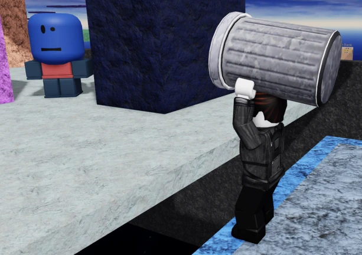

# Pretty Fun Obby

**[▶ Play it on Roblox](https://www.roblox.com/games/139398903012255/Pretty-Fun-Obby)**

<p>
  
</p>
<p>
  
  
</p>

A Roblox obby (obstacle course) side project with four worlds. Players climb stages, collect coins, rebirth, and unlock pets, trails, tools and gamepasses.

The game is written in Luau and developed in VS Code with [Rojo](https://rojo.space), Git and StyLua. This repo holds the scripts only. Maps, GUIs and models live in the Roblox place files.

## Highlights

- **One codebase, four places.** Each world is its own Roblox place running the same code. Players teleport between worlds and keep their progress.
- **Modules load themselves.** A loader starts every server service (23) and client controller (19), so a new system needs no wiring.
- **Typed, reducer-style state.** Player data has a Luau type, and every change goes through one reducer as a typed action.
- **Persistence.** ProfileService handles player saves. Global data stores power cross-server leaderboards.
- **Monetization.** Gamepasses, developer products, a subscription, donations and a coin shop all come from one store config.

## Tooling

| Tool | Purpose |
| --- | --- |
| [Aftman](https://github.com/LPGhatguy/aftman) | Toolchain manager (pins the Rojo version in `aftman.toml`) |
| [Rojo](https://rojo.space) `7.4.4` | Syncs `src/` into Roblox Studio |
| [StyLua](https://github.com/JohnnyMorganz/StyLua) | Formatter (format-on-save is on in `.vscode/settings.json`) |

## Getting started

1. Install Aftman, then install the pinned tools:
   ```sh
   aftman install
   ```
2. Install the Rojo plugin in Roblox Studio (`rojo plugin install`, or get it from the Creator Store).
3. Start the sync server from the repo root:
   ```sh
   rojo serve
   ```
4. Open the world's place in Studio and click **Connect** in the Rojo plugin.

Every Rojo-managed service uses `$ignoreUnknownInstances`, so instances that exist only in the place file (stages, `Remotes`, GUIs, models) stay in place when you sync.

## Worlds

Each world is a separate Roblox place inside the same experience. The worlds are listed in [`Configs/Worlds.lua`](src/ReplicatedStorage/Configs/Worlds.lua):

| Name | Display name | Place ID |
| --- | --- | --- |
| World1 | World 1 | 139398903012255 |
| World2 | World 2 | 71122824760185 |
| World3 | World 3 | 128199095645816 |
| World4 | World 4 | 76460924671569 |

All places share the same codebase. Code that applies to only one world checks `WorldsConfig.IsWorld(...)` / `GetCurrentWorldName()`, or lives under a `Worlds/<WorldName>/Stages/<n>/` folder (for example, the conveyors and trampoline in World 2).

## Project structure

```
src/
├── ReplicatedStorage/        # Shared between server and client
│   ├── Configs/              # Badges, Settings, Sounds, Stages, Trails, Worlds
│   ├── Functions/            # Pure helpers (e.g. UpdateState reducer)
│   ├── Libs/                 # ModuleLoader, ViewportHelper
│   ├── Utils/                # BoundaryUtil, EnemyUtil
│   └── PlayerData.lua        # PlayerData type + default save data
├── ServerScriptService/
│   ├── Loader.server.lua     # Boots every module in Services/
│   ├── Services/             # Server-side game systems
│   ├── Scripts/              # Standalone server scripts (conveyors, enemies)
│   ├── Worlds/               # Per-world, per-stage server scripts
│   └── Libs/ProfileService.lua
├── ServerStorage/
│   └── Configs/Store.lua     # Gamepasses, dev products, store items
└── StarterPlayer/
    ├── StarterPlayerScripts/
    │   ├── Loader.client.lua # Boots every module in Controllers/
    │   ├── Controllers/      # Client-side systems
    │   │   └── Guis/         # One controller per GUI screen
    │   └── Worlds/           # Per-world, per-stage client scripts
    └── StarterCharacterScripts/
scripts/
└── rigger.lua                # Studio helper for rigging pet models (not synced)
```

## Architecture

### Services and controllers

The server and the client each run a single loader script that calls [`ModuleLoader`](src/ReplicatedStorage/Libs/ModuleLoader.lua):

- **Server:** requires every `ModuleScript` under `ServerScriptService/Services`.
- **Client:** requires every `ModuleScript` under `PlayerScripts/Controllers`, and any module added there later.

When a module exports `OnStart`, the loader runs it in its own thread with `task.spawn`. Modules follow this layout:

```lua
local Local = {}   -- private helpers
local Shared = {}  -- public API, returned to other modules

function Shared.OnStart()
	-- connect remotes, player events, etc.
end

return Shared
```

To add a system, create `FooService.lua` in `Services/` or `FooController.lua` in `Controllers/` and give it an `OnStart`. The loader picks it up automatically.

### Player data

- Data is saved with [ProfileService](src/ServerScriptService/Libs/ProfileService.lua) through [`PlayerDataService`](src/ServerScriptService/Services/PlayerDataService.lua).
- The data shape and its defaults live in [`PlayerData.lua`](src/ReplicatedStorage/PlayerData.lua). When you add a field, add it to both the `PlayerData` type and `DEFAULT_PLAYER_DATA`.
- State changes go through action objects (`{ type = "UpdateCoinCount", value = 100 }`) passed to `PlayerDataService.UpdateState`. The reducer in [`Functions/UpdateState.lua`](src/ReplicatedStorage/Functions/UpdateState.lua) handles them. To add a new kind of change, add a new action type to `UpdateStateAction` and handle it there.
- The client keeps a copy of the state through `StateController`.

### Remotes

Remote events live in a `Remotes` folder in `ReplicatedStorage`. Most of them are defined in the place file. [`CreateRemotes.server.lua`](src/ServerScriptService/CreateRemotes.server.lua) creates the rest at runtime.

### Store

Gamepasses, developer products and other store items are configured in [`ServerStorage/Configs/Store.lua`](src/ServerStorage/Configs/Store.lua) and handled by `StoreService` and `DonationService`. Items that cost coins are defined in `CoinService`.

## Rigging a pet model

[`scripts/rigger.lua`](scripts/rigger.lua) turns a model into a pet that can follow the player. The steps are at the top of the file: copy the script into the pet model, run the game, copy the rigged model, stop the game, and paste the model back into the workspace.
